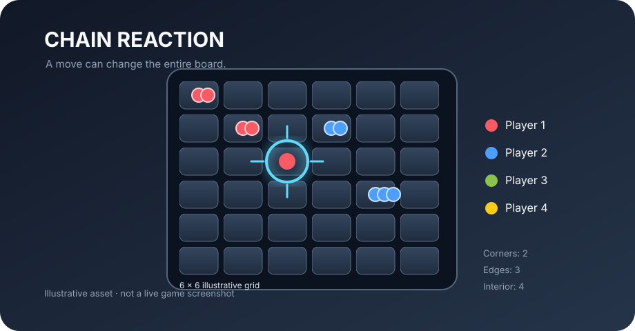

# 💥 Chain Reaction Game

> A turn-based grid strategy game built with React. Place orbs, trigger cascading explosions, capture neighboring cells and outlast your opponents.

  

<strong>Local hot-seat strategy · 2–4 players · Responsive browser game</strong>

  
  
  
  
  
  

## 📸 Game concept

  

> This board image is a project illustration, not a captured runtime screenshot. See [visual assets](docs/assets/README.md).

## 🎮 Overview

Chain Reaction is a shared-device strategy game. Two to four players take turns placing orbs on a rectangular board. Every cell has a critical mass equal to its number of in-bounds orthogonal neighbors. When a cell reaches that threshold, it bursts and distributes one orb to each orthogonal neighbor. Captured cells change to the initiating player's color, which can create further bursts.

**Current mode is local hot-seat play.** Players share one browser. Match state is held in React memory. There is no online matchmaking, account system, persistent match service, database or working multiplayer server.

## ✨ Current capabilities

| Area | Current behavior | Status |
|---|---|---|
| Setup | Choose 2, 3 or 4 local players | Implemented |
| Board | Choose among six grid dimensions | Implemented |
| Turns | One active player at a time | Implemented |
| Legal moves | Empty cells or cells owned by active player | Implemented |
| Critical mass | Corner 2, edge 3, interior 4 | Engine rule |
| Chain reactions | Burst distributes one orb to orthogonal neighbors | Implemented |
| Capture | Affected neighbors become owned by initiating player | Implemented |
| Presentation | Animated orbs, title screen and theme controls | Implemented |
| Diagnostics | Optional browser performance overlay | Implemented |
| Online play | Rooms, remote players and authoritative server | Not implemented |
| Persistence | Accounts, database and saved matches | Not implemented |

## 🧠 Rules and turn lifecycle

1. A player selects an empty cell or a cell they already own.
2. The cell receives one orb and becomes owned by the active player.
3. If its orb count reaches critical mass, it bursts.
4. One orb is transferred to each in-bounds orthogonal neighbor.
5. Neighboring cells become owned by the player who initiated the cascade.
6. Newly unstable cells resolve before the turn advances.
7. The game evaluates eliminations and the match result.

~~~~mermaid
flowchart TD
 A([Player selects cell]) --> B{Empty or owned by active player?}
 B -- No --> C[Reject move without mutation]
 C --> A
 B -- Yes --> D[Add orb and assign ownership]
 D --> E{Critical mass reached?}
 E -- No --> F[Evaluate board]
 E -- Yes --> G[Resolve burst]
 G --> H[Distribute to orthogonal neighbors]
 H --> I[Transfer ownership]
 I --> J{More unstable cells?}
 J -- Yes --> G
 J -- No --> F
 F --> K{Match finished?}
 K -- Yes --> L[Show winner]
 K -- No --> M[Advance turn]
~~~~

See [game rules](docs/game-rules.md), [cascade algorithm](docs/architecture/cascade-resolution.md) and [editable diagrams](docs/architecture/README.md).

## 🚀 Run locally

### Requirements
- Node.js 20.x recommended for CI parity.
- npm and the committed package-lock.json.
- A modern desktop or mobile browser.

### Install and start

~~~~bash
git clone https://github.com/Brajesh31/Chain-Reaction-Game.git
cd Chain-Reaction-Game
npm ci
npm start
~~~~

Open http://localhost:3000.

### Available commands

| Command | Purpose |
|---|---|
| npm start | Start the development server |
| npm test -- --watchAll=false | Run tests once |
| npm run build | Create the production bundle in build/ |
| npm run eject | Eject CRA configuration, irreversible |

### Production hosting
Deploy the contents of build/ to a static host. Configure an SPA fallback to index.html for direct navigation and refresh. See [deployment guide](docs/operations/deployment-hosting.md).

## 🗂️ Repository structure

~~~~text
.
├── .github/
│   ├── ISSUE_TEMPLATE/       # Structured issue forms
│   ├── workflows/            # CI, docs validation and automation
│   └── PULL_REQUEST_TEMPLATE.md
├── docs/
│   ├── architecture/         # Architecture notes and Mermaid sources
│   ├── assets/               # SVG diagrams and visual explanations
│   ├── design/               # UI, accessibility and responsive guidance
│   ├── engineering/          # State, rules, standards and maintenance
│   ├── operations/           # Hosting, runbooks and releases
│   ├── product/              # Requirements and player journeys
│   ├── quality/              # Test strategy, cases and QA
│   ├── screenshots/          # Screenshot capture guidance
│   ├── security/             # Threat model and secure development
│   └── templates/            # Reusable project templates
├── public/                   # App icons and static assets
├── scripts/                  # Repository and documentation validation
├── server/                   # Legacy package manifests; no server source
└── src/
    ├── App.js                # Screen flow and shared theme
    └── components/
        ├── Game.js           # Board state, turns and cascades
        ├── Board.js          # Grid composition
        ├── Cell.js           # Cell and orb presentation
        ├── WelcomePage.js    # Match setup and rules preview
        └── ...               # Controls, title and diagnostics
~~~~

Generated dependencies are not source files. The committed server/node_modules tree has been removed; install packages from lockfiles when needed. The server directory still has manifests only and is not a working backend.

## 📚 Documentation

Start at the [documentation index](docs/README.md).

| Area | Documentation |
|---|---|
| Product | [Brief](docs/product/project-brief.md) · [Requirements](docs/product/requirements.md) · [Feature inventory](docs/product/feature-inventory.md) · [User stories](docs/product/user-stories.md) · [Use cases](docs/product/use-cases.md) · [Player journeys](docs/product/player-journeys.md) |
| Gameplay | [Rules](docs/game-rules.md) · [Strategy guide](docs/product/strategy-guide.md) · [Balance notes](docs/product/gameplay-balance.md) |
| Architecture | [System architecture](docs/architecture.md) · [Game engine](docs/engineering/game-engine.md) · [State model](docs/engineering/state-model.md) · [Cascade algorithm](docs/architecture/cascade-resolution.md) · [Complexity](docs/architecture/algorithm-complexity.md) |
| Engineering | [Development standards](docs/engineering/development-standards.md) · [Browser support](docs/engineering/browser-compatibility.md) · [Dependencies](docs/engineering/dependency-management.md) · [Repository hygiene](docs/engineering/repository-hygiene.md) |
| Quality | [Testing strategy](docs/quality/testing-strategy.md) · [Test cases](docs/quality/test-cases.md) · [QA checklist](docs/quality/qa-checklist.md) · [Regression matrix](docs/quality/regression-matrix.md) · [Playtest script](docs/quality/manual-playtest-script.md) · [Accessibility audit](docs/quality/accessibility-audit.md) |
| Design | [Design system](docs/design/design-system.md) · [Responsive guidance](docs/design/responsive-guidelines.md) · [Accessibility](docs/design/accessibility.md) · [Motion](docs/design/motion-guidelines.md) |
| Security | [Threat model](docs/security/threat-model.md) · [Data handling](docs/security/data-handling.md) · [Frontend security](docs/security/frontend-security.md) · [Dependency security](docs/security/dependency-security.md) |
| Operations | [Runbook](docs/operations/runbook.md) · [Hosting](docs/operations/deployment-hosting.md) · [Environment](docs/operations/environment-configuration.md) · [Monitoring](docs/operations/monitoring.md) · [Backup/recovery](docs/operations/backup-recovery.md) · [Release/rollback](docs/operations/release-rollback.md) |
| Reusable assets | [SVG/diagram index](docs/assets/README.md) · [Templates](docs/templates/README.md) · [Screenshot guide](docs/screenshots/README.md) |

## 🧪 Quality and verification

Pull requests are checked by GitHub Actions:
- Frontend workflow installs from the root lockfile, runs Jest and builds the production bundle.
- Documentation workflow checks local Markdown links and repository hygiene.
- Dependency updates are reviewed through Dependabot and the lockfile.

Run locally:

~~~~bash
npm ci
npm test -- --watchAll=false --runInBand
npm run build
python scripts/validate_docs.py
python scripts/validate_repository.py
~~~~

A passing smoke test is not equivalent to full gameplay verification. Deterministic cascade, elimination and endgame coverage remain explicit quality priorities. See [technical debt](docs/engineering/technical-debt.md).

## 🤝 Contributing
Read [CONTRIBUTING.md](CONTRIBUTING.md), follow the [Code of Conduct](CODE_OF_CONDUCT.md), use the issue and PR templates, and update tests and documentation alongside behavior changes.

## 🔐 Security and privacy
This is a local browser game, not a security-reviewed online service. Never place secrets in frontend source or public build-time environment variables. See [SECURITY.md](SECURITY.md), [PRIVACY.md](PRIVACY.md) and the [threat model](docs/security/threat-model.md).

## 🗺️ Roadmap
Possible future directions include a pure tested game engine, undo/replay, AI opponents, online rooms, an authoritative server and persisted match records. These are proposals, not shipped capabilities. See [ROADMAP.md](ROADMAP.md).

## 📄 License
See [LICENSE](LICENSE) for repository license terms. Review third-party package and asset notices separately.

<strong>💥 Make a move. Trigger a chain. Own the board.</strong>

