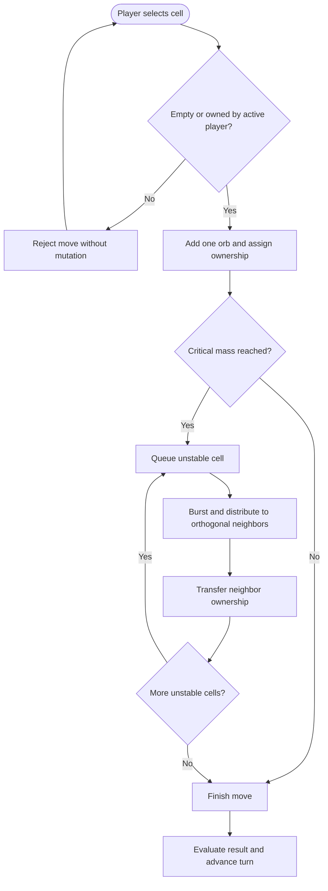

# 💥 Chain Reaction Game

> A turn-based grid strategy game built with React. Place orbs, trigger cascading explosions, capture neighboring cells and outlast your opponents.

<p align="center"></p>
<p align="center"><b>Local hot-seat strategy · 2–4 players · Responsive browser game</b></p>

<p align="center">


</p>

## 🎮 Overview
Chain Reaction is a shared-device strategy game. Two to four players take turns placing orbs on a rectangular board. Each cell has a critical mass determined by its orthogonal neighbors. When a cell reaches its threshold, it bursts and distributes orbs to adjacent cells. The active player's cascade can capture cells and trigger additional bursts.

**Current mode is local hot-seat play.** Players share one browser. State lives in React memory. There is no online matchmaking, account system, persistent match service, database, or working multiplayer server.

## ✨ Current capabilities

| Area | Current behavior |
|---|---|
| Setup | Choose 2, 3 or 4 local players |
| Board | Choose among dimensions exposed by the welcome screen |
| Turns | One active player at a time |
| Legal moves | Empty cells or cells owned by the active player |
| Critical mass | Corner 2, edge 3, interior 4 |
| Chain reactions | Bursts distribute one orb to each orthogonal neighbor |
| Capture | Affected neighbors become owned by the initiating player |
| Presentation | Animated orbs, title screen, theme controls and responsive layout |
| Diagnostics | Optional performance overlay |

> ⚠️ The welcome-screen preview currently shows thresholds 1/2/3, while the engine uses 2/3/4. Treat engine behavior as authoritative until the preview is corrected.

## 🧠 Turn lifecycle



See [game rules](docs/game-rules.md) and [engine design](docs/engineering/game-engine.md).

## 🚀 Run locally

Requirements: Node.js compatible with the Create React App 5 toolchain, npm, and a modern browser.

```bash
git clone https://github.com/Brajesh31/Chain-Reaction-Game.git
cd Chain-Reaction-Game
npm ci
npm start
```

Open http://localhost:3000.

| Command | Purpose |
|---|---|
| `npm start` | Start development server |
| `npm run build` | Build static assets into `build/` |
| `npm test` | Run CRA/Jest test runner |
| `npm run eject` | Eject CRA configuration, irreversible |

⚠️ `src/App.test.js` is still the default CRA sample test and expects the removed “learn react” link. Replace it with game-specific tests before treating the suite as meaningful. No test or build result is claimed by this documentation change.

## 🗂️ Repository layout

```text
.github/                  GitHub workflows and templates
docs/                     Product, rules, architecture, quality, security
  architecture/           Editable Mermaid diagrams
  engineering/            Engine and development standards
  product/                Requirements, user stories and journeys
  quality/                Tests, QA and definition of done
  security/               Threat model and safe development
  operations/              Runbooks and release guidance
  templates/               Reusable project templates
public/                   Static assets
server/                   Package manifests only, no server source
src/
  App.js                  Screen flow and theme
  components/
    Game.js               Board state, turns and cascades
    Board.js              Grid composition
    Cell.js               Cell and orb presentation
    WelcomePage.js        Setup and rules preview
    ...                   Controls, title and performance display
```

The repository currently tracks files under `server/node_modules`. Do not add more dependency artifacts. See [repository hygiene](docs/engineering/repository-hygiene.md).

## 📚 Documentation
- [Documentation index](docs/README.md)
- [Product brief](docs/product/project-brief.md)
- [Requirements](docs/product/requirements.md)
- [Feature inventory](docs/product/feature-inventory.md)
- [Player stories](docs/product/user-stories.md)
- [Use cases](docs/product/use-cases.md)
- [Player journeys](docs/product/player-journeys.md)
- [Rules and gameplay](docs/game-rules.md)
- [Architecture](docs/architecture.md)
- [Game engine](docs/engineering/game-engine.md)
- [State model](docs/engineering/state-model.md)
- [Development standards](docs/engineering/development-standards.md)
- [Repository hygiene](docs/engineering/repository-hygiene.md)
- [Testing strategy](docs/quality/testing-strategy.md)
- [QA checklist](docs/quality/qa-checklist.md)
- [Test cases](docs/quality/test-cases.md)
- [Accessibility audit](docs/quality/accessibility-audit.md)
- [Security](docs/security/threat-model.md)
- [Operations runbook](docs/operations/runbook.md)
- [Release and rollback](docs/operations/release-rollback.md)
- [Reusable templates](docs/templates/README.md)
- [Roadmap](ROADMAP.md)
## 🧰 Technology
React 19, React DOM, Create React App / react-scripts 5, Framer Motion, Styled Components, React Toastify, Jest and React Testing Library dependencies.

Express and Socket.IO appear in package manifests, but there is no checked-in server implementation or socket client connection. Packages alone do not implement online multiplayer.

## 🧪 Known gaps
- [ ] Replace stale CRA sample test with real game tests.
- [ ] Add deterministic critical-mass and cascade tests.
- [ ] Verify elimination and winner detection for 2–4 players.
- [ ] Correct welcome-screen critical-mass preview.
- [ ] Validate accessible keyboard interaction and live status announcements.
- [ ] Decide whether unused server package/dependencies should be removed or implemented.
- [ ] Remove tracked `server/node_modules` artifacts in a reviewed cleanup.
- [ ] Verify dependency compatibility and production build on supported Node.

## 🤝 Contributing
Read [CONTRIBUTING.md](CONTRIBUTING.md), follow [CODE_OF_CONDUCT.md](CODE_OF_CONDUCT.md), and use the issue/PR templates. Rule changes must include tests and documentation updates.

## 🔐 Security
The game is browser-only and local. Never place secrets in frontend source or `REACT_APP_*` variables. See [SECURITY.md](SECURITY.md).

## 🗺️ Future direction
Potential ideas include a pure tested engine, undo/replay, AI opponents, online rooms, an authoritative server and persistent match records. These are proposals, not current features. See [ROADMAP.md](ROADMAP.md).

## 📄 License
See [LICENSE](LICENSE) for repository license terms. Review third-party package and asset notices separately.

<p align="center">💥 Make a move. Trigger a chain. Own the board.</p>

Last updated: 2026-11-17 10:25 UTC
