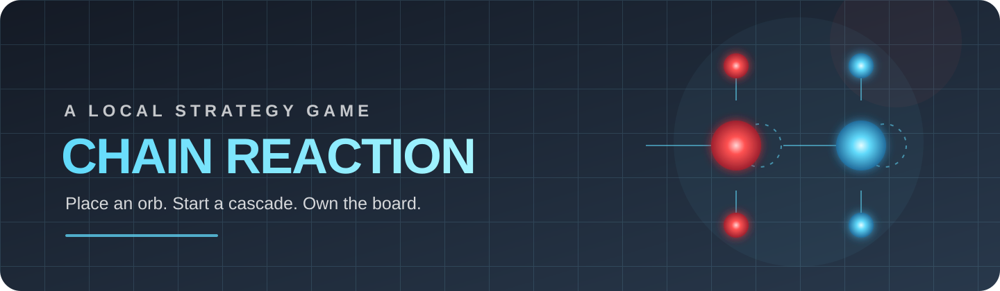

# 💥 Chain Reaction Game

> A turn-based grid strategy game built with React. Place orbs, trigger cascading explosions, capture neighboring cells and outlast your opponents.

  

<strong>Local hot-seat strategy · 2–4 players · Responsive browser game</strong>

  
  
  
  
  
  
  
  
  
  
  
  

## 📸 Game concept

> The board is an illustration, not a captured runtime screenshot. No verified runtime screenshot set is checked in. See [visual assets](docs/assets/README.md) and the [screenshot guide](docs/screenshots/README.md).

## 🎮 Overview

Chain Reaction is a shared-device strategy game. Two to four players take turns placing orbs on a rectangular board. Every cell has a critical mass equal to its number of in-bounds orthogonal neighbors. When a cell reaches that threshold, it bursts and distributes one orb to each orthogonal neighbor. Captured cells change to the initiating player's ownership, which can create further bursts.

**Current mode is local hot-seat play.** Players share one browser. Match state is held in React memory. There is no online matchmaking, account system, persistent match service, database, API or backend service.

## ✨ Current capabilities

| Area | Current behavior | Status |
|---|---|---|
| Setup | Choose 2, 3 or 4 local players | Implemented |
| Board | Choose among six grid dimensions | Implemented in setup |
| Turns | One active player at a time | Implemented |
| Legal moves | Empty cells or cells owned by active player | Implemented |
| Critical mass | Corner 2, edge 3, interior 4 | Engine rule and unit-tested |
| Chain reactions | Pure queued cascade resolution | Implemented and deterministic tests |
| Capture | Affected neighbors become owned by initiating player | Implemented |
| Presentation | Animated orbs, title screen and theme controls | Implemented |
| Diagnostics | Optional browser performance overlay | Implemented |
| Keyboard play | Semantic grid with arrow/Home/End navigation | Implemented and component-tested |
| Reduced motion | Honors operating-system reduced-motion preference | Implemented |
| Online play | Rooms, remote players and authoritative server | Not implemented |
| Persistence | Accounts, database and saved matches | Not implemented |

## 🧠 Rules and turn lifecycle

1. A player selects an empty cell or a cell they already own.
2. The cell receives one orb and becomes owned by the active player.
3. If its orb count reaches critical mass, it bursts.
4. One orb is transferred to each in-bounds orthogonal neighbor.
5. Neighboring cells become owned by the player who initiated the cascade.
6. Newly unstable cells resolve before the turn advances.
7. A bounded burst limit rejects pathological cycles without applying partial board state.
8. A player is not eligible for elimination until taking an opening turn; eliminated players are skipped thereafter.

~~~mermaid
flowchart TD
 A([Player selects cell]) --> B{Empty or owned by active player?}
 B -- No --> C[Reject move without mutation]
 C --> A
 B -- Yes --> D[Add orb and assign ownership]
 D --> E{Critical mass reached?}
 E -- No --> F[Evaluate board]
 E -- Yes --> G[Resolve burst]
 G --> H[Distribute to orthogonal neighbors]
 H --> I[Transfer ownership]
 I --> J{More unstable cells?}
 J -- Yes --> G
 J -- No --> F
 F --> K{Match finished?}
 K -- Yes --> L[Show winner]
 K -- No --> M[Advance turn]
~~~

See [game rules](docs/game-rules.md), [cascade algorithm](docs/architecture/cascade-resolution.md), [application lifecycle](docs/application-lifecycle.md) and [editable diagrams](docs/architecture/README.md).

## 🚀 Run locally

### Requirements
- Node.js 20.x recommended for CI parity.
- npm and the committed package-lock.json.
- A modern desktop or mobile browser.

### Install and start
~~~bash
git clone https://github.com/Brajesh31/Chain-Reaction-Game.git
cd Chain-Reaction-Game
npm ci
npm start
~~~
Open http://localhost:3000.

### Commands
| Command | Purpose |
|---|---|
| npm start | Start development server |
| npm test -- --watchAll=false --runInBand | Run tests once |
| npm run build | Create production bundle in build/ |
| npm run eject | Eject CRA configuration, irreversible |

Deploy build/ to a static host. Configure HTTPS and cache behavior. See [deployment](docs/deployment.md), [production setup](docs/production-setup.md) and [hosting](docs/hosting.md).

## 🗂️ Repository structure

The complete tree is generated from Git and checked in CI. See [project structure](docs/project-structure.md) for the full tree and explanations of major directories and entry points.

~~~text
.
├── .github/                  # Issue/discussion forms, PR guidance and CI/security workflows
├── docs/                     # Product, architecture, design, security and operations handbook
├── public/                   # HTML entry, manifest, icons and static assets
├── scripts/                  # Repository, project-tree and SVG validators
└── src/
    ├── App.js                # Screen flow and shared theme
    ├── components/           # Title, setup, game, board, cells and controls
    └── game/
        ├── rules.js          # Pure move/cascade/player rules
        └── rules.test.js     # Deterministic rule tests
~~~

## ⌨️ Keyboard controls

Tab enters the active cell. Arrow keys move focus. Home/End move to the first/last column. Ctrl+Home/Ctrl+End move to the first/last cell. Enter/Space activates the cell. Turn state is announced through the status region. Reduced-motion preferences are respected.

See [keyboard accessibility](docs/quality/keyboard-accessibility.md) and [screen reader status](docs/accessibility/screen-reader-support.md).

## 📚 Documentation

Start at [docs/README.md](docs/README.md). The [repository enhancement audit](docs/repository-enhancement-audit.md) maps the master checklist to actual files and explicitly records non-applicable features.

| Area | Documentation |
|---|---|
| Product | [Overview](docs/product/product-overview.md) · [Requirements](docs/product/requirements.md) · [Features](docs/product/features.md) · [Personas](docs/product/player-personas.md) · [Journeys](docs/product/player-journeys.md) |
| Gameplay | [Rules](docs/game-rules.md) · [Rules module](docs/engineering/game-rules-module.md) · [Strategy](docs/product/strategy-guide.md) |
| Architecture | [Architecture](docs/architecture.md) · [Technical overview](docs/technical-overview.md) · [Components](docs/component-architecture.md) · [Project structure](docs/project-structure.md) |
| Engineering | [Standards](docs/code-standards.md) · [Dependencies](docs/external-dependencies.md) · [Configuration](docs/configuration.md) · [Technical debt](docs/engineering/technical-debt.md) |
| API/data | [API status](docs/api.md) · [Database status](docs/database.md) · [Data flow](docs/data-flow.md) · [Integrations](docs/integrations.md) |
| Quality | [Testing](docs/testing.md) · [Unit tests](docs/quality/unit-testing.md) · [Integration status](docs/quality/integration-testing.md) · [QA](docs/quality/qa-checklist.md) · [Quality gates](docs/quality/quality-gates.md) |
| Design/accessibility | [Design system](docs/design/design-system.md) · [Tokens](docs/design/design-tokens.md) · [Accessibility](docs/accessibility.md) · [WCAG target/status](docs/accessibility/wcag-compliance.md) |
| Security/privacy | [Security overview](docs/security.md) · [Threat model](docs/security/threat-model.md) · [Dependency security](docs/security/dependency-security.md) · [Privacy](docs/privacy.md) |
| Operations | [Deployment](docs/deployment.md) · [CI/CD](docs/ci-cd.md) · [Runbook](docs/operations/runbook.md) · [Release/rollback](docs/operations/release-rollback.md) |
| Reusable assets | [SVG/banner index](docs/assets/README.md) · [Templates](docs/templates/README.md) · [Screenshot guide](docs/screenshots/README.md) |

## 🧪 Quality and verification

GitHub Actions runs:
- Frontend CI: npm ci, Jest and production build.
- Documentation: Markdown links, repository hygiene, generated tree and SVG validation.
- CodeQL and secret scanning.
- Dependency review and npm audit reporting.

A green audit-report workflow means the report was generated and uploaded, not that every advisory is fixed.

Run locally:
~~~bash
npm ci
npm test -- --watchAll=false --runInBand
npm run build
python scripts/validate_docs.py
python scripts/validate_repository.py
python scripts/check_project_structure.py --check
python scripts/validate_svg.py
~~~

The rules module has deterministic tests for neighbor geometry, critical mass, move legality, bursts, cascades, cycle-limit rollback, opening participation and next-player selection. A component regression test verifies that input remains locked through cascade presentation. Full match integration tests and manual screen-reader/contrast verification remain open priorities.

## 🤝 Contributing
Read [CONTRIBUTING.md](CONTRIBUTING.md), follow [CODE_OF_CONDUCT.md](CODE_OF_CONDUCT.md), use the issue and PR templates, and update tests/docs alongside behavior changes. See [AUTHORS.md](AUTHORS.md), [MAINTAINERS.md](MAINTAINERS.md), [CITATION.cff](CITATION.cff) and [asset attribution](ASSET_ATTRIBUTION.md) for ownership and attribution context.

## 🔐 Security and privacy
This is a local browser game, not a security-reviewed online service. Never put secrets in frontend source or public build-time variables. See [SECURITY.md](SECURITY.md), [PRIVACY.md](PRIVACY.md) and the [threat model](docs/security/threat-model.md).

## 🗺️ Roadmap
Undo/replay, AI opponents, online rooms, an authoritative server and persisted match records are proposals, not shipped capabilities. See [ROADMAP.md](ROADMAP.md).

## 📄 License
The root [LICENSE](LICENSE) is limited to documentation-scope material. It does not automatically grant rights to pre-existing application code or third-party content. Review [asset attribution](ASSET_ATTRIBUTION.md) and source provenance before redistribution.

<strong>💥 Make a move. Trigger a chain. Own the board.</strong>

