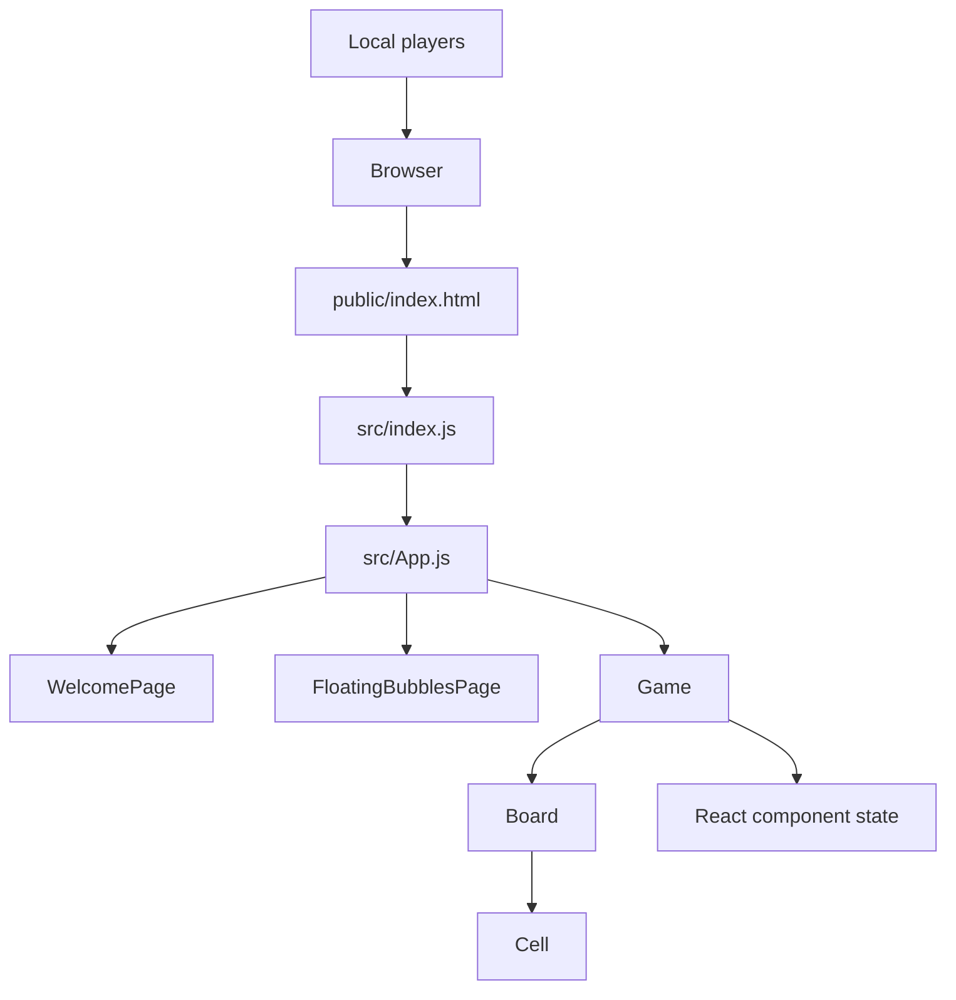
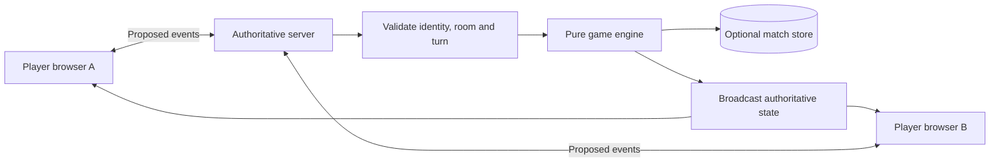

# 🏗️ Architecture

## System boundary
The checked-in application is a client-side React single-page game. The browser owns the match session. There is no runtime API, database, account system or online game service.

## Component responsibilities

| Module | Responsibility |
|---|---|
| `src/index.js` | React root and Web Vitals setup |
| `src/App.js` | Screen transitions, setup settings and shared theme |
| `FloatingBubblesPage.js` | Animated title page |
| `WelcomePage.js` | Grid/player setup and rule preview |
| `Game.js` | Board state, moves, turns, cascades and winner logic |
| `Board.js` | Two-dimensional grid rendering |
| `Cell.js` | Cell, orb and explosion presentation |
| `GameControls.js` | Reset, theme and performance controls |
| `PerformanceMonitor.js` | Browser-side diagnostics |

## State ownership
Game state is held in React component state. It includes the board, current player, player count, terminal status and presentation settings. There is no durable store.

## Networking status
Express and Socket.IO packages appear in manifests, but inspection found no server entry point, HTTP routes, socket handlers, client connection, database adapter or authentication. The nested `server` folder has manifests only. Dependency presence is not a feature.

## Future online architecture (not implemented)

Before implementation define event schemas, identity, room lifecycle, reconnect behavior, rate limits and server-side move validation. See [API status](api.md) and [threat model](security/threat-model.md).
