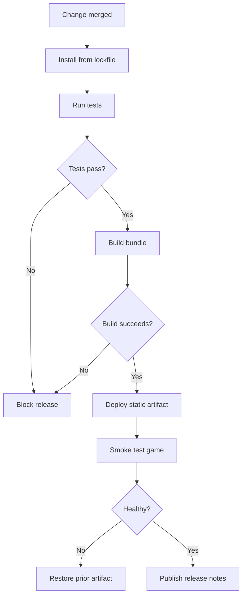

# 🚦 Release and Rollback

## Preparation
Confirm scope; install from lockfile; run tests/build; complete gameplay, responsive and accessibility QA; update docs/changelog; verify artifact; record SHA.

## Flow

Rollback triggers: app unavailable, gameplay/state corruption or critical accessibility regression. Record release/rollback SHAs, reason, time, verification and follow-up issue.
