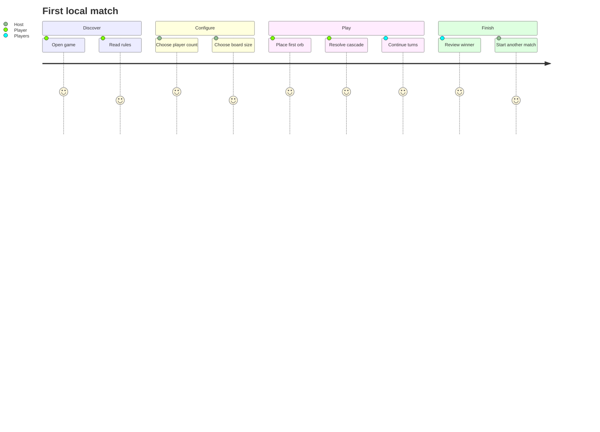

# 🗺️ Player Journeys

## First local match

## Critical moments
1. Before the first move, clarify the legal-move rule and active player.
2. On selection, show accepted/rejected feedback.
3. During cascades, communicate resolution and prevent conflicting input.
4. After resolution, show ownership and next player.
5. At game end, clearly identify terminal state and restart action.

## Friction to evaluate
- Setup preview critical-mass values differ from the engine, as noted in README.
- Large grids may overflow narrow screens.
- Explosion animations may distract or discomfort some users.
- Color-only ownership is insufficient for some players.

No analytics system was identified. These are usability checks, not tracked metrics.
