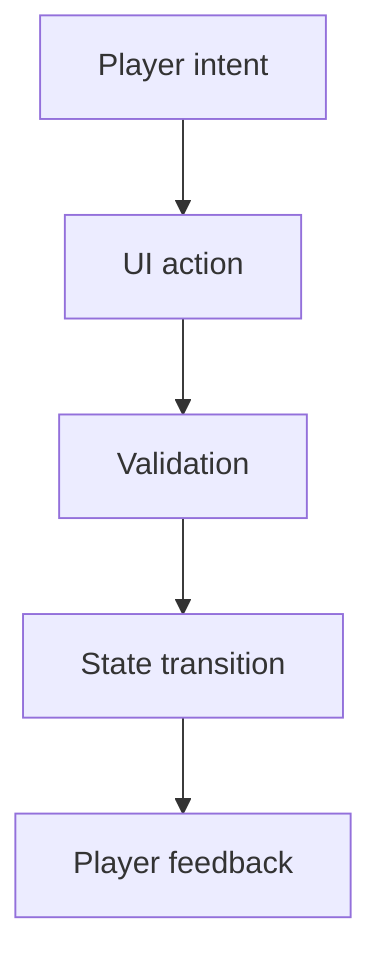

# ✨ Feature Proposal: [Name]

## Summary
Player problem and intended outcome.

## User value
Audience, problem and expected improvement.

## Scope
### Included
- [Specific behavior]
### Excluded
- [Non-goals]

## Interaction flow

## Acceptance criteria
| ID | Given | When | Then |
|---|---|---|---|
| AC-01 | [State] | [Action] | [Result] |

## Rule impact
Critical mass, neighbors, cascade order, ownership, elimination and turn advancement.

## Accessibility
Keyboard, screen reader, contrast, motion, touch and zoom.

## Technical approach, risks and tests
Components, state, engine functions, dependencies, alternatives and automated/manual verification.

## Rollout
Release notes, docs and rollback criteria.
